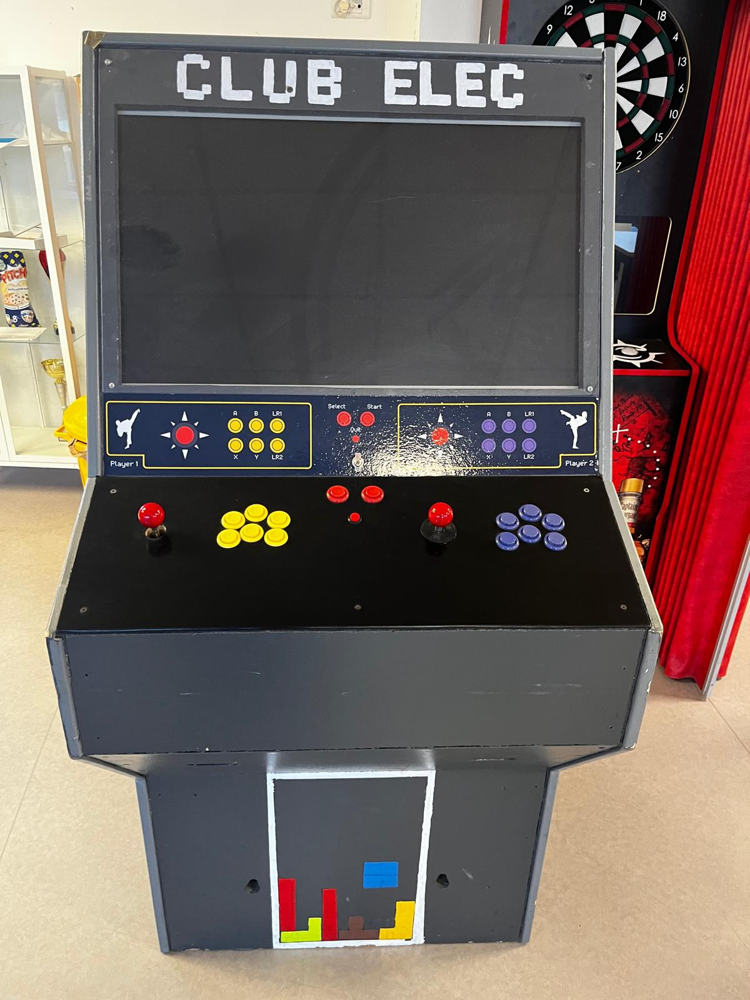
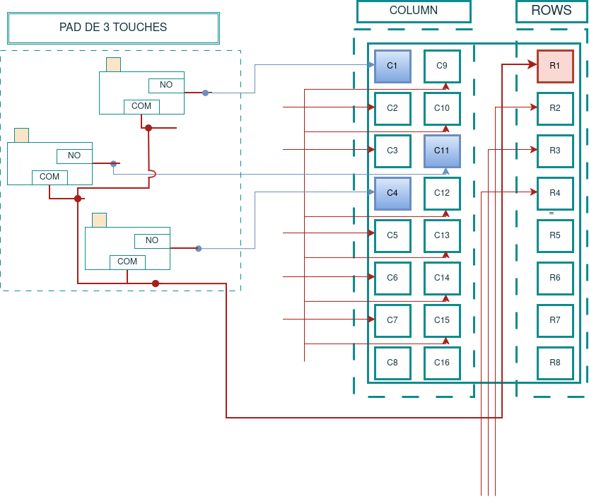
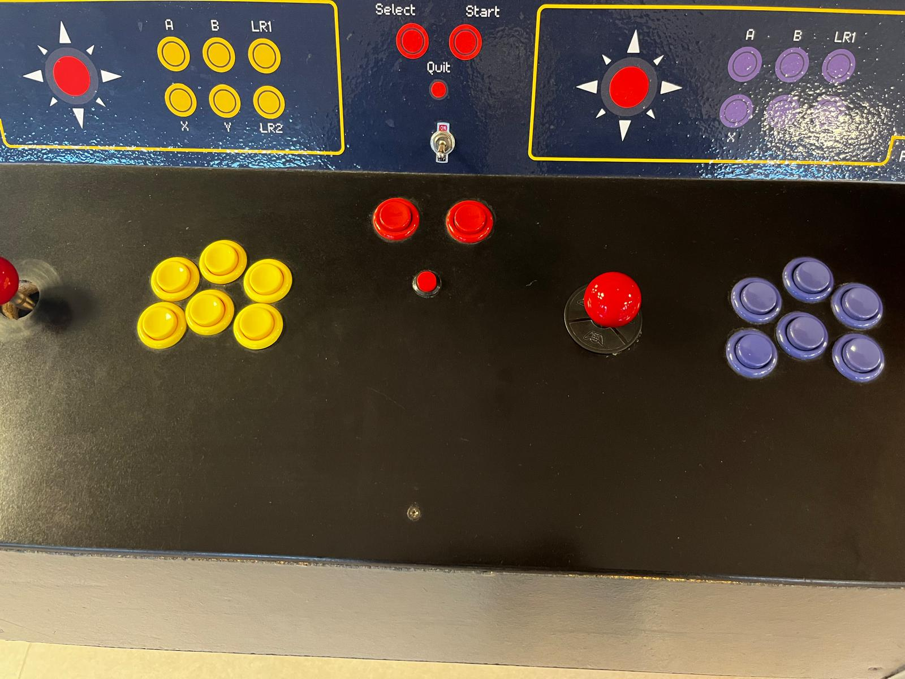

# Arcade-machine

Ceci a pour but de mettre en évidence la documentation des méthodes choisies pour réparer l'actuelle borne d'arcade.

### Description électronique
---

Un diagnostic de la machine a été effectué afin de recenser les composants qu'elle contient, de mieux les protéger et, le cas échéant, de les remplacer s'ils sont défaillants. Le tableau suivant les présente.

  
| Composants | Référence technique |
| :--- | :--- |
| Écran | Panasonic Plasma |
| Unité | Raspberry Pi 3B+ |
| Carte mère | Module TNPA4031 |
| Carte de jeu | Encodeur CLA-PS/2 |
| Micro-switch | Série D4* |
| Carte de puissance | Panasonic sustain |

> [!WARNING]
> Cependant, l'utilisation du nouveau système d'exploitation [**Recalbox**](https://wiki.recalbox.com/fr/home) implique un fichier de configuration des touches sensiblement différent, ce qui rend le pilotage moins intuitif. _La machine fonctionnait auparavant sous Arch Linux._
>
> De plus, le câblage de l'électronique de la machine ne relève pas vraiment d'un « chef-d'œuvre » : il faudrait refaire toute la connectique pour la rendre plus lisible.
>
> Enfin, le manque de sécurisation du montage ne garantit pas une sécurité suffisante, tant pour le mainteneur que pour le matériel.

### Choix de l'unité de commande
---

Théoriquement, pour une machine d'arcade, une bonne vieille Raspberry ferait l'affaire (les caractéristiques à prendre en compte dépendent des jeux que l'on souhaite faire tourner). Mais, en pratique, on n'est jamais à l'abri d'un freeze[^1], d'une surchauffe, etc. C'est pour cela qu'un PC bien équipé (ventirad, ventilateur, régulateur de tension, etc.) peut s'avérer utile dans ce genre d'entreprise.

> [!NOTE]
> Dans notre cas, nous allons rester sur un Raspberry Pi 3B+, faute de PC...[_cliquer ici pour plus d'informations sur le modèle_](https://www.raspberrypi.com/documentation/computers/getting-started.[...]

### Encodeur PS/2
---

Il s'agit du module permettant de gérer l'interaction entre les boutons et le système. Comme le montre l'image ci-contre, il est monté en parallèle, avec 2 colonnes pour 1 ligne (ce qui peut être considéré comme une matrice pour faciliter la compréhension). À cet effet, vous pouvez consulter [la représentation matricielle](https://www.smallcab.net/telechargement/manuel/keyboard_PS2_to_panel_fr.pdf) (_pour un clavier AZERTY de 105 touches_) afin d'obtenir une meilleure représentation.  

### Microswitch
---

Ce sont des interrupteurs rattachés aux boutons, qui laissent passer le courant lorsqu'ils sont pressés. Le signal est ensuite perçu par l'encodeur, qui attribue une lettre du clavier à chaque bouton. [_Consulter la documentation du microswitch_](https://www.alldatasheet.com/datasheet-pdf/view/809054/CHERRY/D413-R1AA-G2.html)

> [!TIP]
> Ces interrupteurs possèdent une borne commune (COM) et une borne normalement ouverte (NO). Dans une matrice, chaque microswitch relie une ligne (R) à une colonne (C) lorsqu'il est actionné.

<ins>**Exemple**</ins> : pour 3 interrupteurs reliés à 3 colonnes différentes (C1, C2 et C3) et à une même ligne (R), on obtient les combinaisons suivantes : R-C1, R-C2 et R-C3. Chacune correspond à une touche du clavier.

### Logiciel et Pi 3B+
---

La Raspberry Pi 3B+ choisie offre des performances largement suffisantes pour faire tourner les jeux. [_Plus d'informations sur le module_](https://wiki.recalbox.com/fr/hardware-compatibility/raspberry-pi). Qu'en est-il du logiciel ?

Le système de rétrogaming[^2] Recalbox propose plusieurs paramètres de configuration, notamment dans le fichier `/recalbox/share/system/recalbox.conf`. Le matériel doit également présenter une certaine [compatibilité](https://wiki.recalbox.com/fr/hardware-compatibility) pour que le système fonctionne correctement.

Pour le mappage des touches, le logiciel est compatible avec une certaine [gamme d'encodeurs](https://wiki.recalbox.com/fr/hardware-compatibility/compatible-devices/input). Pour en ajouter d'autres, il est possible de configurer le logiciel. [_Comment ajouter un encodeur USB ?_](https://wiki.recalbox.com/fr/tutorials/controllers/usb-encoders/recalbox-for-your-usb-keyboard-encoder)

### Configuration des touches
---

Comme le montre l'image ci-dessus, les boutons d'arcade possèdent des boutons standard `X`, `Y`, `A`, `B`, `LR1`, `LR2`, `SELECT` et `START`, qui permettent d'interagir avec le système [consulter conf-manettes snes](https://wiki.recalbox.com/fr/basic-usage/first-use-and-configuration).

La Hotkey[^3] est une touche essentielle à définir pour accéder à un panel de commandes rapides pendant le jeu. [_Voir les commandes Hotkey_](https://wiki.recalbox.com/fr/basic-usage/getting-start[...]

> [!NOTE]
> Ces boutons sont basés sur ceux de la SNES[^4] de Nintendo.

#### Documentation supplémentaire

Le schéma de la carte électronique de puissance du téléviseur Panasonic, qui sert d'écran d'affichage, peut être consulté via [ce lien](https://www.csportal.panasonic-la.com/descargaspla/PLA/TELEVIS[...]

[^1]: Blocage temporaire d'un ordinateur ou d'un processeur pendant l'exécution de processus.
[^2]: Logiciel permettant de jouer à plusieurs jeux de plateformes différentes sur une seule machine.
[^3]: Bouton permettant l'activation de commandes spéciales dans un émulateur.
[^4]: Super Nintendo Entertainment System, console Nintendo dont s'inspire la manette.
